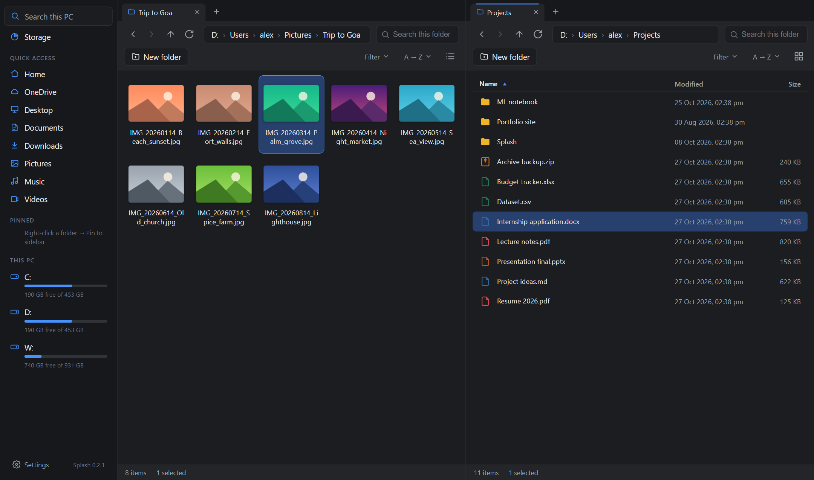
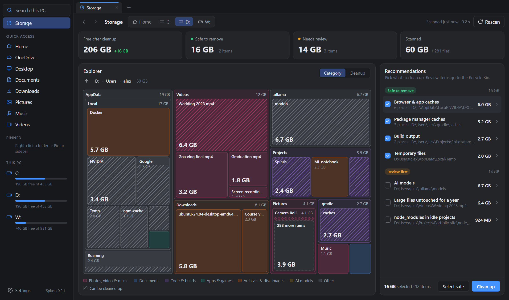

# Splash

**A fast, lightweight file explorer for Windows.** Tabs, split view, drag and
drop, photo previews, archives and instant whole-PC search, in a 1.8 MB
installer that opens a 25,000-item folder in under a second.

Free and open source (MIT). Built with [Tauri 2](https://tauri.app) (Rust) and React.



**[Download for Windows](https://github.com/NeerajPratapSingh/Splash/releases/latest)** (1.8 MB installer, Windows 10/11)

## Features

- **Search this PC** (`Ctrl+Shift+F`). Find any file or folder on every drive by part of its name. An optional index answers in milliseconds (about 0.05 s across 1.2 million files), and *Open file location* jumps straight to it.
- **Storage** (sidebar). See what's taking up space on a drive or your Home folder as a map of boxes sized by how much room they take, and clean up caches, temp files and leftovers. More below.
- **Make it your default.** One switch in Settings opens folders, drives and `Win+E` in Splash instead of File Explorer; turning it off (or uninstalling) hands everything back.
- **Tabs and split view.** Open folders in tabs (`Ctrl+T`); hover a tab to put it side by side with another (`F3`).
- **Drag and drop** between panes, tabs, the sidebar, and to or from Windows Explorer and the desktop. Moves within a drive, copies across drives (`Ctrl` = copy, `Shift` = move), with **Undo** and **Move instead** right after.
- **Photo and video thumbnails** from Windows' own thumbnail cache, plus a full-size preview on `Space`.
- **Archives.** Compress to ZIP; extract ZIP, 7z, RAR and TAR/GZ. Never overwrites existing files.
- **The full right-click menu.** Open with, Properties, Open in Terminal, Copy as path, and everything other apps add (WinRAR, OneDrive, PowerRename, Send to…), in submenus that open on hover.
- **Sorting and filtering.** Sort by name (natural `1, 2, 10` order), date, size or type; group by date or type; filter by kind. Remembered per folder, and Downloads shows the newest first, like Explorer.
- **Sidebar.** Quick access, OneDrive, your pinned folders (right-click a folder → *Pin to sidebar*) and drives with free-space bars.
- **Keyboard first.** Arrows, type-to-jump, `Ctrl+L` to type a path, and the shortcuts below.
- **Auto-refresh.** Changes from other programs (a finished download, a saved file) show up on their own.
- **Fast with huge folders.** Only the rows on screen are drawn.
- Deleting always goes to the **Recycle Bin**.

## Storage: find what's filling your drive

Click **Storage** in the sidebar, then **Scan** your Home folder or a whole
drive (about 5–20 seconds). Splash measures every folder and shows:



- **A map of your space.** Every box is a folder or file, sized by how much it
  takes up.
  - **Click a box to look inside it.** Go back up with the ↑ arrow, the path
    above the map, or `Backspace`.
  - **Right-click a box** to open it, show it in its folder, or move it to the
    Recycle Bin.
  - **Striped boxes can be cleaned up.** A striped band along the bottom of a
    box shows how much of it can go.
  - **Category / Cleanup** switches between colouring by file type and
    highlighting what's safe to remove (green) or worth reviewing (amber).
- **Recommendations**, grouped by why:
  - **Safe to remove:** things apps rebuild on their own (browser and app
    caches, temp files, npm/pip/Gradle/Cargo caches, build output of idle
    projects).
  - **Review first:** AI models, the Android SDK, `node_modules` in idle
    projects, old installers in Downloads, and big files untouched for a year.

**Clean up** deletes the safe items (caches and temp files) right away, the
way Windows' own Disk Cleanup does, since apps rebuild them. Review items go
to the Recycle Bin, so you can still get them back; you can empty it from the
same panel. Cache and Temp folders are emptied rather than removed, and files
in use are skipped. A progress bar shows how far along it is.

## Install

Download `Splash_x.y.z_x64-setup.exe` from the [Releases](../../releases)
page and run it. Requires Windows 10 or 11 (64-bit).

> The installer isn't code-signed yet, so Windows SmartScreen may show
> "Windows protected your PC". Click **More info → Run anyway**.

## Keyboard shortcuts

| Action | Keys |
|---|---|
| New tab / close tab / next tab | `Ctrl+T` / `Ctrl+W` / `Ctrl+Tab` |
| Split view on/off | `F3` |
| Search this PC | `Ctrl+Shift+F` |
| Type a path | `Ctrl+L` (or click the address bar) |
| Back / Forward / Up | `Alt+←` / `Alt+→` / `Alt+↑`, `Backspace` = back |
| Move selection / extend | `↑ ↓ ← →` / `Shift+arrows`, `Home`, `End` |
| Jump to a name | just start typing |
| Preview photo | `Space` (`←` `→` to browse) |
| Open | `Enter` / double-click |
| Rename | `F2` |
| Delete (to Recycle Bin) | `Del` |
| Copy / Cut / Paste | `Ctrl+C` / `Ctrl+X` / `Ctrl+V` |
| Copy as path | `Ctrl+Shift+C` |
| Properties | `Alt+Enter` |
| New folder | `Ctrl+Shift+N` |
| Select all / clear selection | `Ctrl+A` / `Esc` |
| Grid / list view | `Ctrl+Shift+V` |
| Search this folder | `Ctrl+F` (`Enter` searches subfolders) |
| Refresh | `F5` |

## Build from source

You need:

1. [Node.js](https://nodejs.org) LTS
2. [Rust](https://rustup.rs) (default `x86_64-pc-windows-msvc` toolchain)
3. [Visual Studio Build Tools](https://visualstudio.microsoft.com/visual-cpp-build-tools/) with **Desktop development with C++**
4. WebView2. It ships with Windows 10/11; otherwise get the [Evergreen runtime](https://developer.microsoft.com/microsoft-edge/webview2/).

```powershell
npm install
npm run tauri dev     # run with hot reload (first build takes a few minutes)
npm run tauri build   # installer -> src-tauri/target/release/bundle/nsis/
```

## Project layout

```
src/                     React + TypeScript UI
  App.tsx                tabs, panes, clipboard, drops, notices, shortcuts
  components/
    Explorer.tsx         one tab: history, listing, selection, menus, keys
    FileView.tsx         virtualized list/grid, thumbnails, rename
    Storage.tsx          Storage view: treemap, stats, cleanup recommendations
    Pane.tsx, TabBar.tsx, Sidebar.tsx, Toolbar.tsx, ContextMenu.tsx …
  api.ts                 typed calls into the Rust backend
  dnd.ts                 native drag and drop
  treemap.ts             squarified treemap layout
  thumbs.ts, viewPrefs.ts, util.ts
src-tauri/src/           Rust backend
  lib.rs                 Tauri commands
  fs_ops.rs              file operations (list, copy, move, rename, trash…)
  space.rs               Storage: parallel disk scan, cleanup rules, Recycle Bin
  archive.rs             ZIP create/extract; 7z/RAR/TAR via Windows' tar
  shell.rs               Windows shell: right-click entries, Properties, Open with
  thumbs.rs              thumbnails from the Windows thumbnail cache
  watch.rs               auto-refresh when folders change
```

## Contributing

Bug reports and pull requests are welcome. Please open an
[issue](../../issues) first for bigger changes, so we can agree on the approach.

## Support

Splash is free and always will be. If it saves you time and you'd like to
say thanks, you can buy me a coffee. It's completely optional, and it helps
me keep working on it. <!-- TODO: Buy Me a Coffee link -->

## License

[MIT](LICENSE) © 2026 Neeraj Pratap Singh
